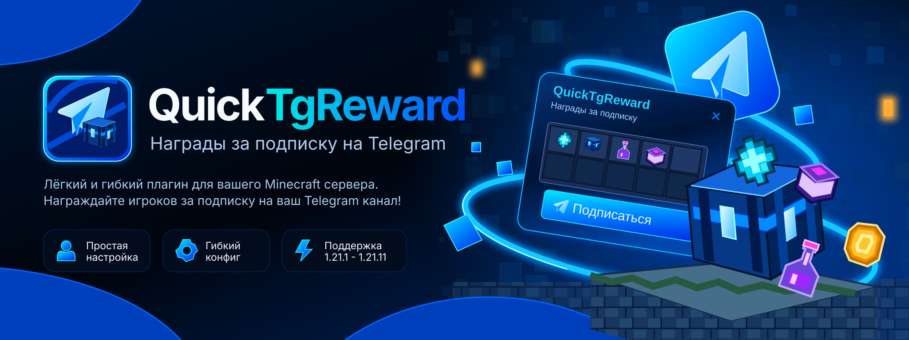

<p align="center">
  
</p>

<h1 align="center">QuickTgReward</h1>

<p align="center">
  <strong>Система наград через Telegram для Minecraft-серверов</strong><br>
  by <a href="https://github.com/QuickProducts">QuickProducts</a>
</p>

<p align="center">
  
  
  
  
  
</p>

---

## Описание

**QuickTgReward** — современный плагин для Paper, который связывает Minecraft-аккаунты с Telegram и выдаёт настраиваемые награды за подписку на канал.

Игроки привязывают аккаунт одноразовым кодом, подписываются на ваш канал и получают еженедельные (или любые другие) награды прямо на сервере.

### Особенности

- Красивое меню в чате Minecraft (MiniMessage, градиенты, кликабельные кнопки)
- Полноценный Telegram-бот с inline-меню
- Проверка подписки через `getChatMember`
- Гибкая система наград: команды, предметы, Vault, опыт, LuckPerms, случайные награды
- Кулдауны, одноразовые и повторяемые награды
- SQLite + HikariCP, транзакции, защита от повторной выдачи
- Полностью настраиваемые сообщения, кнопки, цвета
- Модульная архитектура, асинхронные запросы к Telegram
- Tab-completion и permissions

---

## Скриншоты (предпросмотр интерфейса)

> Реальные скриншоты появятся после установки на сервер. Ниже — описание интерфейса.

**Minecraft-чат**
```
QuickTgReward • Telegram Rewards
Статус аккаунта: Не привязан
Статус награды: Доступна после привязки
Привяжите Telegram, подпишитесь на канал и получайте награды!
[Привязать аккаунт]  [Открыть Telegram]
```

**Telegram-бот**
- Главное меню с кнопками «Получить награду», «Привязать Minecraft», «Мой профиль» и др.
- Профиль с ником, статусом подписки и временем следующей награды

---

## Установка

1. Скачайте последний `QuickTgReward-x.x.x.jar` из [Releases](https://github.com/QuickProducts/QuickTgReward/releases).
2. Поместите JAR в папку `plugins/` вашего Paper-сервера (1.21.1+).
3. Запустите сервер один раз, чтобы создались конфиги.
4. Настройте `plugins/QuickTgReward/telegram.yml` — укажите токен бота и ID канала.
5. Перезапустите сервер или выполните `/qtgreward reload`.

### Создание бота

1. Откройте [@BotFather](https://t.me/BotFather) в Telegram.
2. `/newbot` → укажите имя и username.
3. Скопируйте токен в `telegram.yml` → `bot.token`.
4. Укажите `bot.username` без `@`.

### Добавление бота в канал

1. Добавьте бота в ваш канал/группу как **администратора**.
2. Выдайте право «Просмотр участников» / «Add Users» (нужно для `getChatMember`).
3. Укажите ID канала (`@username` или `-100...`) в `telegram.yml` → `channel.id`.
4. Укажите invite-ссылку в `channel.invite-link`.

---

## Конфигурация

Основные файлы:

| Файл | Назначение |
|------|------------|
| `config.yml` | Основные настройки, кулдауны, лимиты |
| `messages.yml` | Все сообщения Minecraft |
| `telegram.yml` | Токен, тексты и кнопки бота |
| `rewards.yml` | Награды и действия |
| `gui.yml` | Цвета и оформление |
| `database.yml` | SQLite и пул соединений |

Пример `config.yml` уже содержит рекомендуемые значения. Все параметры реально используются в коде.

**Важно:** токен бота никогда не должен попадать в публичные репозитории. Используйте `.gitignore` или секреты CI.

---

## Команды

### Игроки

| Команда | Описание | Permission |
|---------|----------|------------|
| `/tg` | Главное меню | `qtgreward.use` |
| `/tg link` | Получить код привязки | `qtgreward.link` |
| `/tg unlink confirm` | Отвязать аккаунт | `qtgreward.unlink` |
| `/tg reward` | Получить награду | `qtgreward.reward` |
| `/tg status` | Статус аккаунта | `qtgreward.status` |
| `/tg help` | Справка | `qtgreward.use` |

### Администраторы

| Команда | Описание | Permission |
|---------|----------|------------|
| `/qtgreward reload` | Перезагрузить конфиги | `qtgreward.admin.reload` |
| `/qtgreward status` | Статус Telegram-бота | `qtgreward.admin` |
| `/qtgreward give <player> <reward>` | Выдать награду | `qtgreward.admin.give` |
| `/qtgreward reset <player>` | Сбросить награды | `qtgreward.admin.reset` |
| `/qtgreward unlink <player>` | Принудительно отвязать | `qtgreward.admin.unlink` |
| `/qtgreward check <player>` | Проверить данные | `qtgreward.admin.check` |

---

## Permissions

```
qtgreward.use          — базовые команды (default: true)
qtgreward.link         — привязка
qtgreward.unlink       — отвязка
qtgreward.reward       — получение наград
qtgreward.status       — просмотр статуса
qtgreward.admin        — все админ-команды (default: op)
qtgreward.admin.reload
qtgreward.admin.give
qtgreward.admin.reset
qtgreward.admin.unlink
qtgreward.admin.check
```

---

## Сборка из исходников

Требуется **JDK 21**.

```bash
git clone https://github.com/QuickProducts/QuickTgReward.git
cd QuickTgReward
./gradlew build
```

Готовый JAR: `build/libs/QuickTgReward-1.0.0.jar`

На Windows (PowerShell):

```powershell
.\gradlew.bat build
```

---

## FAQ

**Бот не запускается**  
Проверьте токен и наличие интернета. В логах не должно быть «token not set».

**Проверка подписки не работает**  
Бот должен быть администратором канала с правом просмотра участников. ID канала должен быть корректным.

**Награда не выдаётся**  
Игрок должен быть онлайн. Проверьте `rewards.yml` и наличие Vault/LuckPerms при необходимости.

**Код привязки не принимается**  
Код одноразовый и живёт 5 минут (настраивается). Не превышайте лимит попыток.

---

## Troubleshooting

| Проблема | Решение |
|----------|---------|
| `ClassNotFoundException` | Используйте Shadow JAR из Releases |
| SQLException | Проверьте права на папку `plugins/QuickTgReward/data` |
| TelegramApiException | Проверьте токен и права бота |
| Двойная выдача | Плагин использует транзакции; убедитесь, что не запускаете два инстанса |

---

## Лицензия

MIT © QuickProducts

---

<p align="center">
  Made with ❤️ by <strong>QuickProducts</strong>
</p>
